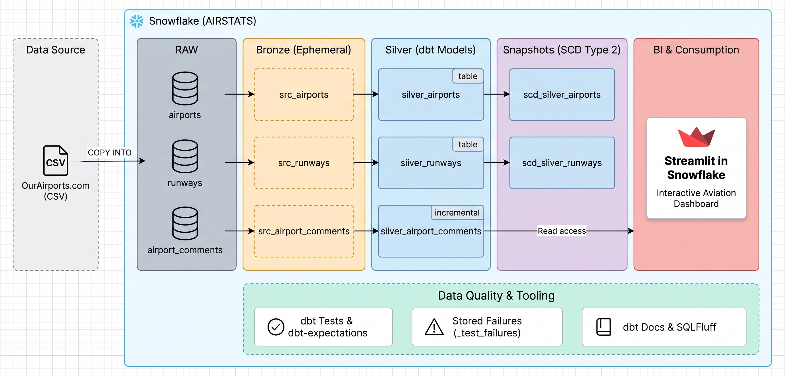

# AirStats: Global Aviation Analytics Pipeline

An end-to-end analytics engineering project built with **dbt Core** and **Snowflake** to transform, validate, and track historical changes across global aviation data from [OurAirports](https://ourairports.com/data/).

---

## Architecture Overview

The pipeline follows a **Medallion Architecture** with ephemeral staging models, materialized analytical tables, incremental ingestion, Slowly Changing Dimensions (SCD Type 2), and automated data quality testing.



### Tech Stack
- **Data Warehouse:** Snowflake (`AIRSTATS` database)
- **Transformation & Modeling:** `dbt-core` (`~1.11.0`), `dbt-snowflake` (`~1.11.0`)
- **Data Quality:** Built-in dbt tests, `metaplane/dbt_expectations`, and custom singular SQL tests
- **SQL Linting:** `SQLFluff` with the dbt templater (`snowflake` dialect)
- **Environment Management:** Python 3.13 managed via `uv`

---

## Data Models & Pipeline Layers

For full source table schemas and column definitions, see [DATASETS.md](DATASETS.md).

### 1. Sources (`models/sources.yml`)
Defined under the `airstats` source pointing to the `RAW` schema in Snowflake:
- `airports` (~72K rows): Global airport registry keyed by ICAO code (`ident`).
- `runways` (~44K rows): Physical runway dimensions, surface materials, and lighting/closure status.
- `comments` (`airport_comments`): User-submitted airport comments and feedback.

### 2. Bronze Layer (`models/bronze/`)
Materialized as **`ephemeral`** to keep the warehouse clean while encapsulating source selection and standardized column naming via CTEs:
- `src_airports`: Selects and standardizes airport identifiers, classifications, coordinates, and ISO geo codes.
- `src_runways`: Selects and renames runway attributes with consistent `runway_*` prefixes.
- `src_airport_comments`: Standardizes comment metadata and maps `date` to `comment_timestamp`.

### 3. Silver Layer (`models/silver/`)
Configured as **`table`** by default in `dbt_project.yml`, with `silver_airport_comments` overridden as **`incremental`**:
- `silver_airports`: Clean core dimension table of global airports.
- `silver_runways`: Standardizes null or empty `runway_surface` values to `__UNKNOWN__`.
- `silver_airport_comments`:
  - Materialized incrementally (`on_schema_change='fail'`) using `comment_id` as a high-watermark filter.
  - Filters out records with null or empty `comment_body`.
  - Replaces null `member_nickname` values with `__UNKNOWN__`.
  - Appends a `loaded_at` (`current_timestamp()`) audit column.

### 4. Snapshots (`snapshots/snapshots.yml`)
Tracks historical attribute changes (SCD Type 2) using the **`check`** strategy across all columns (`check_cols: all`, `hard_deletes: invalidate`):
- `scd_silver_airports` (unique key: `airport_ident`)
- `scd_silver_runways` (unique key: `runway_id`)

### 5. Analyses (`analyses/`)
- `la_heliport_closed.sql`: Ad-hoc analytical query inspecting historical SCD Type 2 records in `scd_silver_airports` for airport `01CN` (*Los Angeles County Sheriff's Department Heliport*) to verify status transitions (e.g., operational to `closed`).

### Data Lineage (dbt Docs)

Generated automatically via `dbt docs generate`, illustrating end-to-end dependencies from raw sources through ephemeral staging, silver models, SCD Type 2 snapshots, and analyses:


---

## Data Quality & Testing

All test failures are automatically persisted to Snowflake in the `_test_failures` schema (`+store_failures: true` in `dbt_project.yml`) for downstream auditing and debugging.

| Test Category | Implementation |
|---|---|
| **Primary Key Integrity** | `unique` and `not_null` on `airport_ident`, `runway_id`, and `comment_id` |
| **Domain Validation** | `accepted_values` on `silver_airports.airport_type` (`small_airport`, `medium_airport`, `large_airport`, `heliport`, `seaplane_base`, `balloonport`, `closed`) |
| **Referential Integrity** | `relationships` tests linking `silver_runways` and `silver_airport_comments` to `silver_airports` via `airport_ident` (`severity: warn`) |
| **dbt-expectations** | `expect_column_values_to_be_between` for latitude (`-90` to `90`) and longitude (`-180` to `180`); `expect_column_values_to_be_of_type` (`timestamp_ntz`) on `comment_timestamp` |
| **Singular Tests** | `test_airports_valid_coordinates.sql` (validates geographic coordinate bounds) and `test_runways_positive_dimensions.sql` (flags non-positive runway dimensions with `severity: warn`) |

---

## Project Structure

```text
.
├── DATASETS.md                              # Raw dataset documentation & ER overview
├── README.md                                # Project overview & usage guide
├── architecture.jpg                         # Pipeline architecture diagram
├── data lineage.png                         # dbt Docs DAG / data lineage graph
├── pyproject.toml                           # Python & dbt dependencies (uv)
├── uv.lock                                  # Locked dependency versions
└── airstats/                                # dbt project root
    ├── dbt_project.yml                      # dbt project configuration
    ├── packages.yml                         # External dbt packages (dbt_expectations)
    ├── models/
    │   ├── sources.yml                      # Snowflake RAW source definitions
    │   ├── bronze/                          # Ephemeral staging models
    │   │   ├── src_airports.sql
    │   │   ├── src_runways.sql
    │   │   └── src_airport_comments.sql
    │   └── silver/                          # Cleaned analytical models & docs
    │       ├── silver_airports.sql
    │       ├── silver_runways.sql
    │       ├── silver_airport_comments.sql
    │       ├── schema.yml                   # Model/column docs & data tests
    │       ├── _docs.md                     # Reusable dbt doc blocks
    │       └── overview.md                  # Silver layer documentation
    ├── snapshots/
    │   └── snapshots.yml                    # SCD Type 2 snapshot definitions
    ├── tests/                               # Custom singular SQL tests
    │   ├── test_airports_valid_coordinates.sql
    │   └── test_runways_positive_dimensions.sql
    └── analyses/
        └── la_heliport_closed.sql           # Historical snapshot validation query
```

---

## Getting Started

### Prerequisites
- Python `3.13` and [`uv`](https://docs.astral.sh/uv/)
- A Snowflake account (free trial works)

### 1. Clone & Install Dependencies

```bash
git clone https://github.com/<your-username>/<your-repo-name>.git
cd <your-repo-name>

# Create the virtual environment and install dbt-core, dbt-snowflake, and SQLFluff
uv sync

# Install external dbt packages (metaplane/dbt_expectations)
cd airstats
uv run dbt deps
```

### 2. Prepare Raw Data in Snowflake

1. In a Snowflake SQL Worksheet, create the database and schemas:

```sql
CREATE DATABASE IF NOT EXISTS AIRSTATS;
CREATE SCHEMA IF NOT EXISTS AIRSTATS.RAW;
CREATE SCHEMA IF NOT EXISTS AIRSTATS.DEV;
```

2. Download `airports.csv`, `runways.csv`, and `airport-comments.csv` from [OurAirports.com](https://ourairports.com/data/) and load them into `AIRSTATS.RAW` as `AIRPORTS`, `RUNWAYS`, and `AIRPORT_COMMENTS` (via Snowflake UI: **Data -> Databases -> AIRSTATS -> RAW -> Create -> Table -> From File**).
   - Ensure the `date` column in `AIRPORT_COMMENTS` is typed as `TIMESTAMP_NTZ`.
   - Because the raw `airport-comments.csv` uses camelCase headers, standardize them to `snake_case`:

```sql
ALTER TABLE AIRSTATS.RAW.AIRPORT_COMMENTS RENAME COLUMN AIRPORTIDENT TO AIRPORT_IDENT;
ALTER TABLE AIRSTATS.RAW.AIRPORT_COMMENTS RENAME COLUMN MEMBERNICKNAME TO MEMBER_NICKNAME;
ALTER TABLE AIRSTATS.RAW.AIRPORT_COMMENTS RENAME COLUMN THREADREF TO THREAD_REF;
ALTER TABLE AIRSTATS.RAW.AIRPORT_COMMENTS RENAME COLUMN AIRPORTREF TO AIRPORT_REF;
```

### 3. Configure Snowflake Profile

Create `airstats/profiles.yml` (already gitignored so credentials are never committed):

```yaml
airstats:
  target: dev
  outputs:
    dev:
      type: snowflake
      account: "<your_snowflake_account_identifier>"
      user: "<your_snowflake_login_name>"
      password: "<your_password_or_programmatic_access_token>"
      # Or use key-pair auth instead of password:
      # private_key_path: "/path/to/rsa_key.p8"
      # private_key_passphrase: "<your_passphrase>"
      role: "ACCOUNTADMIN"
      database: "AIRSTATS"
      schema: "DEV"
      warehouse: "COMPUTE_WH"
      threads: 4
```

> **Note on Snowflake PAT:** If your Snowflake account enforces MFA, generate a **Programmatic Access Token (PAT)** in Snowflake Settings, paste it into `password:`, and ensure a Network Policy is active on your account/user.

Verify the connection from inside `airstats/`:

```bash
uv run dbt debug --profiles-dir .
```

### 4. Run the Pipeline & Inspect Docs

```bash
# Run all models, snapshots, and data tests in dependency order
uv run dbt build --profiles-dir .

# Or run individual stages:
uv run dbt run --profiles-dir .
uv run dbt snapshot --profiles-dir .
uv run dbt test --profiles-dir .

# Refresh only the incremental comments model
uv run dbt run --select silver_airport_comments --profiles-dir .

# Generate and serve interactive dbt documentation & lineage graph
uv run dbt docs generate --profiles-dir .
uv run dbt docs serve --profiles-dir .

# Lint SQL models with SQLFluff
uv run sqlfluff lint models/
```

---

## Data Attribution

All aviation datasets are sourced from [OurAirports.com](https://ourairports.com/data/) and released under the **Public Domain**.
